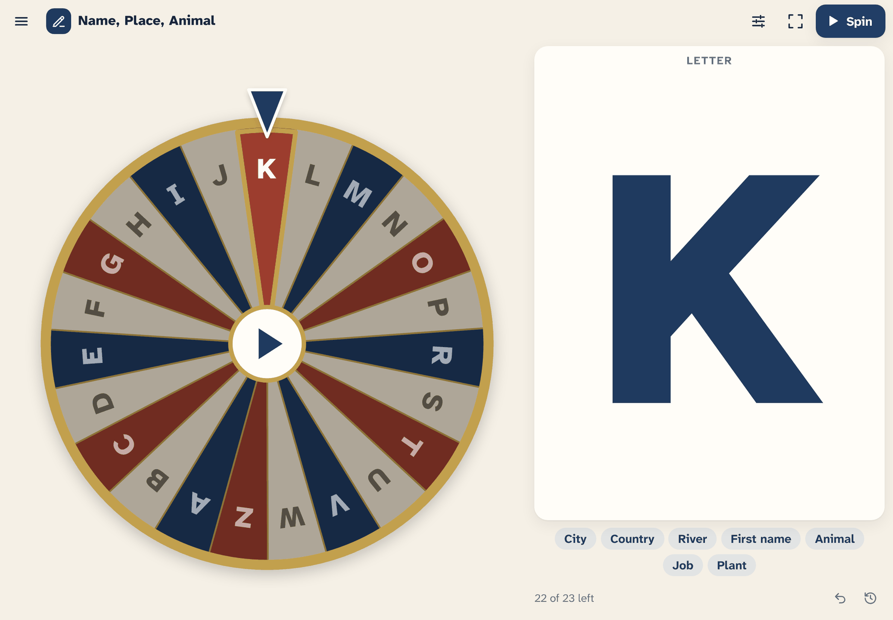
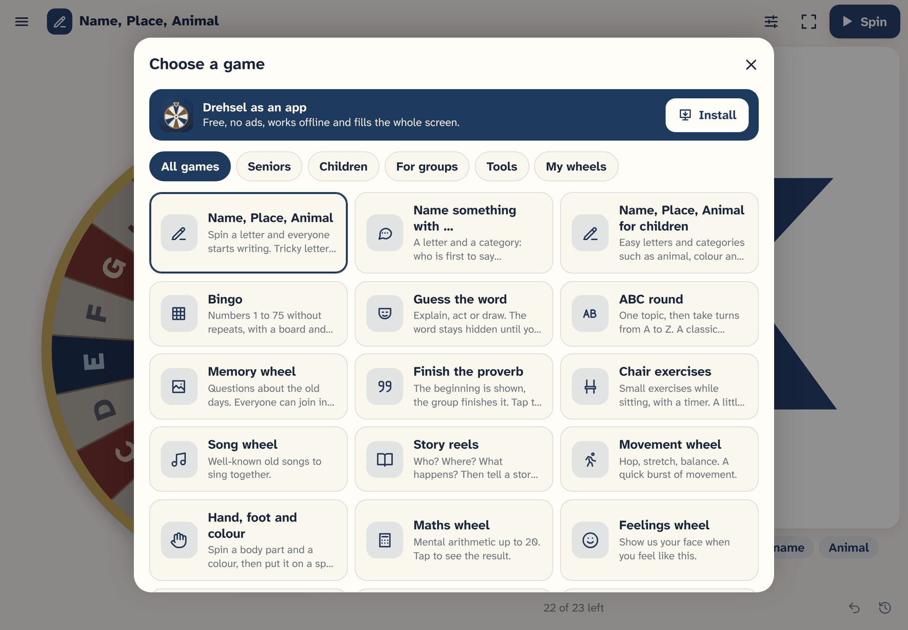
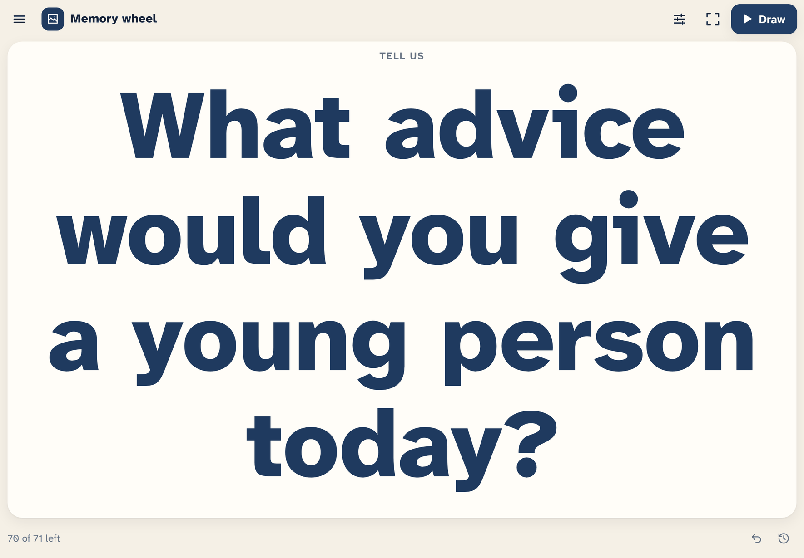
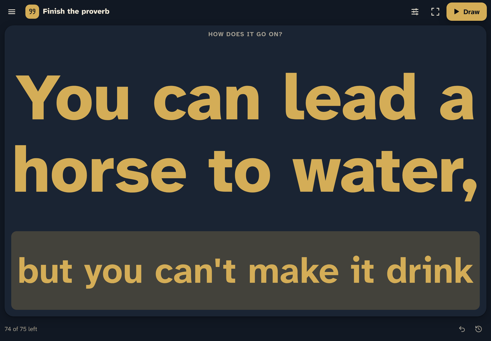
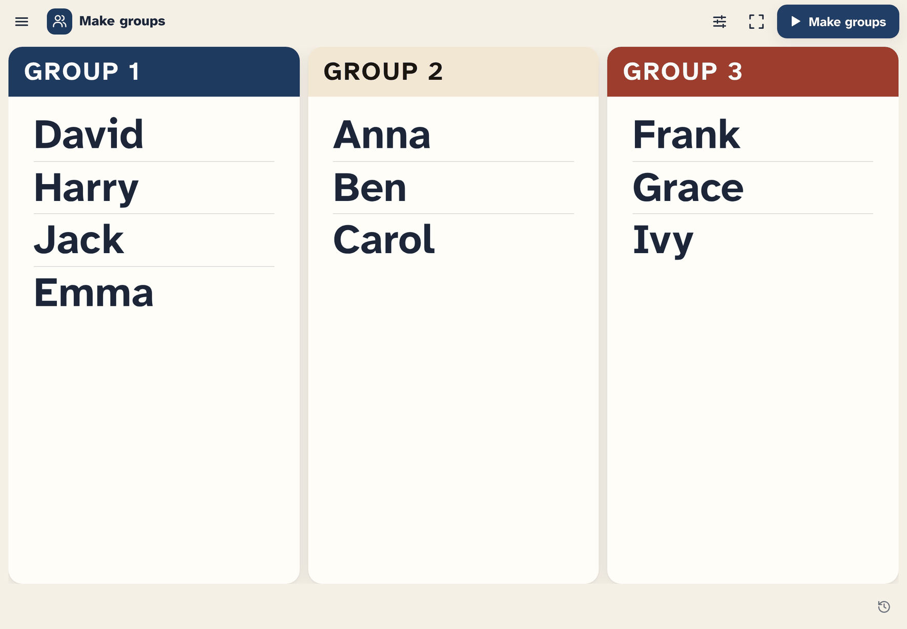
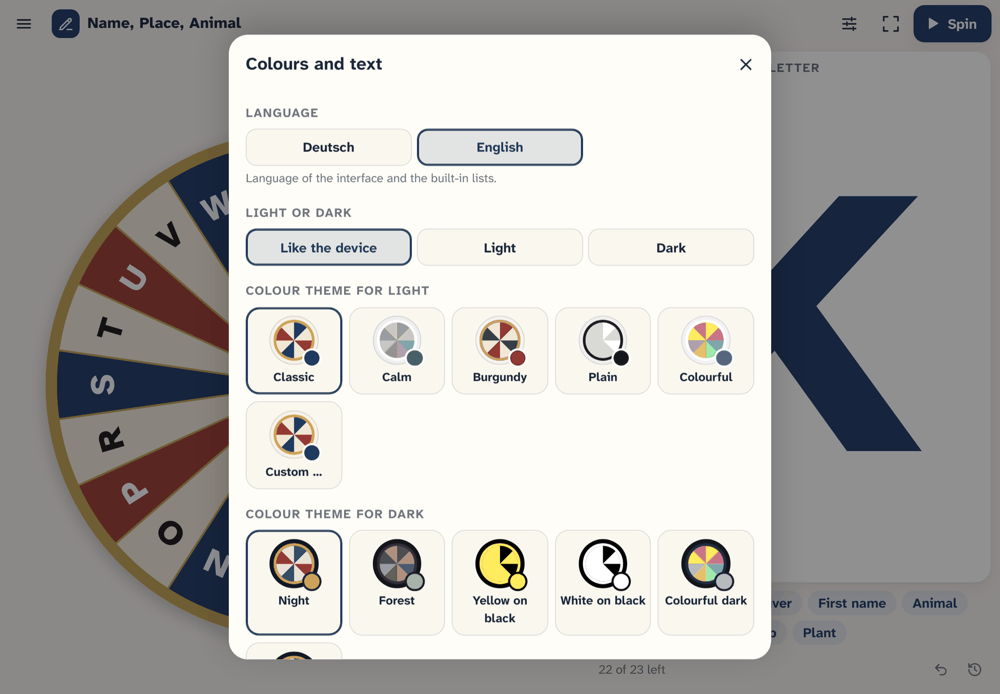
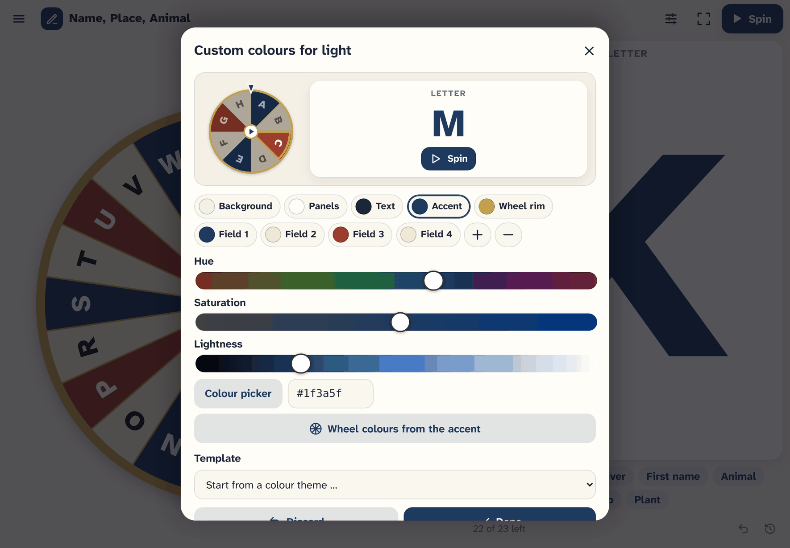
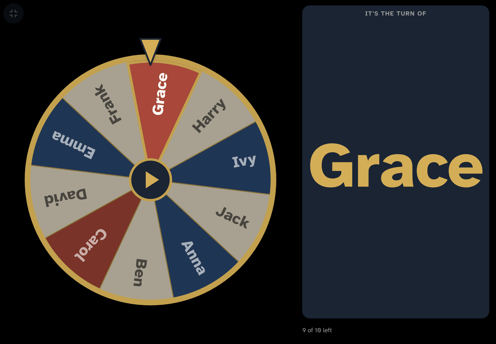
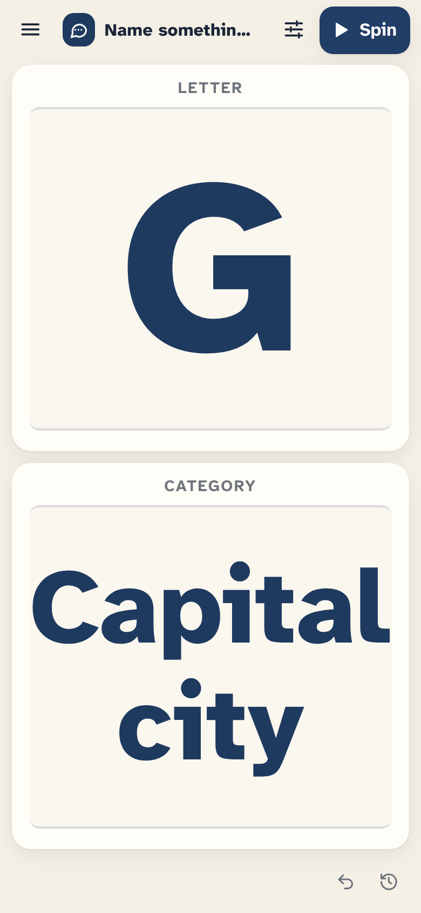
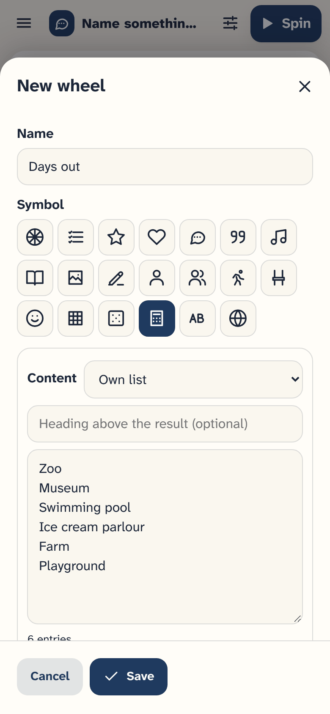

# Drehsel

[Deutsch](README.md) · **English**

[](#requirements)
[](#licence)
[](https://ko-fi.com/burnersen)

## 🎡 [Try it now: drehsel.burnersen.de](https://drehsel.burnersen.de)

**Spinning wheel, lucky draw and dice for games with seniors and children.** Free, no sign-up, no ads. Just open it in the browser and, if you like it, add it as an app to your phone, tablet or computer. Everything you create stays on your own device.

**[⬇️ Download the latest release](../../releases/latest)** · **[🌐 tech.burnersen.de](https://tech.burnersen.de/en/)** · **[☕ Buy me a coffee](https://ko-fi.com/burnersen)**

Made for everyone who keeps groups busy: care homes, nurseries, schools, families. The result fills all the space there is, in easy-to-read fonts and colours, and can be read aloud. On a tablet, a TV or a projector.

<p align="center">
  
</p>

<table>
  <tr>
    <td align="center" width="33%"><br><sub>28 games and tools</sub></td>
    <td align="center" width="33%"><br><sub>Reels for several things at once</sub></td>
    <td align="center" width="33%"><br><sub>Bingo with board and spoken numbers</sub></td>
  </tr>
  <tr>
    <td align="center"><br><sub>Card for long texts</sub></td>
    <td align="center"><br><sub>Tap for the answer</sub></td>
    <td align="center"><br><sub>Make groups</sub></td>
  </tr>
  <tr>
    <td align="center"><br><sub>Colour themes for light and dark</sub></td>
    <td align="center"><br><sub>Colour mixer for every colour</sub></td>
    <td align="center"><br><sub>Presentation mode for TV and projector</sub></td>
  </tr>
  <tr>
    <td align="center"><br><sub>On a phone</sub></td>
    <td align="center"><br><sub>Your own wheels in a minute</sub></td>
    <td></td>
  </tr>
</table>

> 💜 **Do you like Drehsel?** A ⭐ on GitHub is the easiest way to tell me. Or [tell me what you use it for](../../issues/new), I read every message. Thank you!

## Games

| For everyone | Seniors | Children | Tools |
|---|---|---|---|
| Name, Place, Animal (with timer and categories) | Memory wheel (72 questions about the old days) | Story reels (Who? Where? What happens?) | Letters (no repeats, tricky ones can be left out) |
| Name something with … (letter and category) | Finish the proverb (with answers) | Movement wheel (40 ideas to get moving) | Numbers (range, step, with or without repeats) |
| Bingo (1 to 75, board, spoken numbers) | Chair exercises (35, with timer) | Hand, foot and colour | Dice (1 to 9, with pips and total) |
| Guess the word (hidden; explain, act, draw) | Song wheel (old songs) | Maths wheel (plus, minus, times, divided) | Lottery 6 from 49 |
| ABC round (a topic, then A to Z) | | Feelings, rhymes, children's songs | Yes or no, toss a coin |
| | | What if …? (questions to talk about) | Whose turn?, make groups, hand out jobs |

Every game can be adjusted, and you can add as many wheels of your own as you like.

## How it works

- **Spin:** tap “Spin” at the top, the wheel, or anywhere on the play area. A quick swipe across the wheel spins it that way. On a computer, space, Enter and the arrow keys work, so a presentation clicker does too.
- **Faster:** tap again while it spins.
- **Display:** wheel to watch, reels for several things at once, card for long texts such as questions. Switch under “Adjust” (slider button at the top).
- **Drawing:** with repeats, each once and then start again, or each only once until a new round (as in bingo). With “each once” the wheel only shows what is still in the pot.
- **Answers:** proverbs, rhymes and sums show the answer only after a tap.
- **Hidden:** in “Guess the word” only the person who taps sees the word.
- **Timer:** per game if you like, starts by itself after the spin, with a gong at the end.
- **Read aloud:** via the device's speech output, on by default for bingo.
- **Undo and history:** bottom right, where you also find “New round”.
- **Fair randomness:** the result comes from the device's real random number generator, evenly distributed. The wheel only spins to it.

## Easy to read

- **The result is as big as the space allows.** Words are never split.
- **Five fonts, all built in:** Atkinson Hyperlegible (made by the Braille Institute for people with low vision), Fibel (based on Andika, for beginning readers), Lexend, Nunito and the device's own font.
- **Colour themes:** Classic, Calm, Burgundy, Plain and Colourful for light, Night, Forest, Yellow on black, White on black and Colourful dark for dark. Light or dark fixed or like the device.
- **Colour mixer:** set background, panels, text, accent, rim and every field colour on the wheel yourself, with preview, colour picker and colour code.
- **Automatic contrast:** every text colour is adjusted so it stays easy to read on its background, big results at least 7 : 1, everything else at least 4.5 : 1. The labels of every wheel field too.
- **Text sizes:** sliders for controls, result, wheel labels and small texts, plus the weight and, if you like, CAPITALS.

## Your own lists

- **New wheel:** name, symbol, type or paste the entries. Several reels for combinations.
- **Adjust built-in lists:** hide single entries and add your own. Reset brings everything back.
- **Copy as your own wheel:** any built-in game with its entries, then change it freely.
- **Import and export text files**, or paste lists from WhatsApp, e-mail or a column in Excel.
- **Share via link:** the wheel is inside the link after the `#`. That part never reaches the server, nothing is stored.
- **Backup file:** take everything along to another device.

The text format Drehsel reads and writes:

```
[Days out]
Zoo
Museum
Playground | with a picnic

== Dinner ==
[Starter]
Soup
Salad
[Main course]
Pasta
Fish
```

One line per entry. `[Name]` starts a list, `== Name ==` a wheel with several reels. After `|` comes an answer that only appears after a tap. `#rrggbb` at the end of a line gives a field its own colour, e.g. `Red #e03131`. Two columns from Excel become question and answer.

## TV, projector, Apple TV

- **Presentation mode** (button with four corners or key F): only the wheel and the result, filling the screen, and the screen stays on. Tap to spin, top left takes you back.
- **iPad on Apple TV:** hold the iPad sideways and turn on rotation lock in Control Centre. The iPad has a different shape from the TV (about 4:3 instead of 16:9), so mirroring leaves borders left and right. With the black background in presentation mode they are hardly noticeable. Installed as an app, Safari's bars disappear as well.
- Only App Store apps can send a separate 16:9 picture to the TV, a web app cannot.

## Where your data lives

**Everything stays on the device:** your wheels, adjustments, players, settings, history. None of it goes to the server. Drehsel sets no cookies, counts no one and loads nothing from other servers, no fonts, no scripts, no statistics.

**What the server stores:** nothing about visitors. The `data/` folder only holds settings and the update state.

**What goes out:** only the question to GitHub whether there is a new version, at most every 15 minutes. Nothing personal is sent.

## Three ways to Drehsel

1. **Just use it:** open [drehsel.burnersen.de](https://drehsel.burnersen.de) and install it as an app (on iPhone and iPad via Share → “Add to Home Screen”). After that Drehsel also works without internet.
2. **No server, as a file:** download `drehsel-offline.html` from the [latest release](../../releases/latest) and double-click it, on a computer or from a USB stick. Everything is inside this one file (about 500 KB). On iPhone and iPad use way 1, HTML files from the Files app don't run properly there.
3. **On your own web space:** see [Installation](#installation).

## Requirements

- PHP 7.4 or newer (8.x recommended). No database.
- **HTTPS.** Without HTTPS the app cannot be installed and does not work offline.
- For automatic updates: `curl` or `allow_url_fopen`, and the web space must allow outgoing connections.
- Apache and LiteSpeed protect the internal folders by themselves via `.htaccess`. **nginx** needs two lines, see below.

## Installation

1. Download `drehsel-install.php` from the [latest release](../../releases/latest) and copy it into a folder on your web server, for example `/drehsel/`.
2. PHP must be allowed to write to this folder (it creates `index.php`, the folder `app/` and later `data/`).
3. Open `drehsel-install.php` in the browser and click “Install now”. The file unpacks the program, deletes itself and takes you to Drehsel.
4. **Check that the internal folders are protected:** `https://your-address/drehsel/data/config.php` and `https://your-address/drehsel/app/lib/core.php` must show “403 Forbidden” or “404 Not Found”.

**Prefer doing it by hand?** The release also contains `drehsel-<version>.zip`. Unpack it and upload the contents of the folder `drehsel/`, i.e. `index.php`, `LICENSE` **and** the folder `app/`.

**nginx:** add these two lines to the `server` block, after backing up the configuration:

```sh
# Back up the configuration (path depends on your system)
sudo cp -a /etc/nginx/sites-available/default /etc/nginx/sites-available/default.bak

# Add (Drehsel lives in the folder /drehsel/ here):
#   location ^~ /drehsel/data/ { deny all; }
#   location ^~ /drehsel/app/  { deny all; }
sudo nano /etc/nginx/sites-available/default

# Test and reload
sudo nginx -t && sudo systemctl reload nginx

# If something goes wrong: restore and reload
sudo cp -a /etc/nginx/sites-available/default.bak /etc/nginx/sites-available/default && sudo systemctl reload nginx
```

## Updates

**Automatic:** Drehsel checks the latest GitHub release at most every 15 minutes, and only after a page has been delivered. If there is a new version, the installer is downloaded, verified by checksum and applied. The running version is saved in `data/update-prev.txt` first, `data/` is never touched. Devices pick up the new version the next time they open Drehsel.

To switch it off, in `data/config.php`:

```php
return array (
  'auto_update' => false,
);
```

**By hand:** upload the new `drehsel-install.php` and open it.

## Structure

```
index.php      entry: serves files, service worker, manifest, the page
app/lib/       settings, headers, updates (PHP)
app/views/     the main page, also the template for the offline file
app/assets/    the app in the browser:
               engine.js  randomness, drawing, history, groups, jobs, sharing, built-in games
               stage.js   wheel, reels, card, dice, bingo board, timer
               look.js    colour themes and automatic contrast
               app.js     controls, windows, settings, own wheels, backup
               i18n-en.js translation, fonts (WOFF2), icons, service worker, CSS
app/lists/     the built-in lists, one text file per language
app/licenses/  font licences (SIL Open Font License)
tools/         build the release, check logic, lists and translations (command line only)
```

No frameworks, no dependencies, no build step, no database.

## Extending lists and languages

The built-in lists are in `app/lists/de.txt` and `app/lists/en.txt`:

```
[sprichwoerter] Proverbs
An apple a day | keeps the doctor away
Practice | makes perfect
```

`[id] Name` starts a list, followed by one entry per line. The ids are the same in all languages, the games themselves are defined in `app/assets/engine.js`.

**New language:** copy `app/assets/i18n-en.js` to `i18n-xx.js`, set `_name` and translate the texts, then create `app/lists/xx.txt`. Drehsel finds both by itself.

To check:

```sh
node tools/test-engine.js     # randomness, drawing, undo, groups, jobs, sharing
node tools/check-lists.js     # duplicate entries, missing lists
node tools/check-i18n.js      # missing translations
php tools/build-release.php   # dist/drehsel-install.php, ZIP and drehsel-offline.html
```

On GitHub the “Prüfen” action checks every pull request. A tag such as `1.0.1` starts the “Release” action, which builds and attaches all files.

## ☕ Support

Drehsel is free and made in my spare time. If it makes you happy and you'd like to say thanks, you can [leave a small tip on Ko-fi](https://ko-fi.com/burnersen). Completely voluntary, and either way: thank you!

**More from me:** [Suchsel](https://suchsel.burnersen.de) (word search puzzles with your own words, printable), [Kaufen](https://tech.burnersen.de/en/tools/kaufen-en/) (shared shopping lists) and more on [tech.burnersen.de](https://tech.burnersen.de/en/).

## Licence

GNU Affero General Public License v3.0, see [LICENSE](LICENSE). The fonts are licensed under the SIL Open Font License 1.1, see [app/licenses/](app/licenses/).
