# Drehsel

**Deutsch** · [English](README.en.md)

[](#voraussetzungen)
[](#lizenz)
[](https://ko-fi.com/burnersen)

## 🎡 [Jetzt ausprobieren: drehsel.burnersen.de](https://drehsel.burnersen.de)

**Glücksrad, Losbox und Würfel für Spiele mit Senioren und Kindern.** Kostenlos, ohne Anmeldung und ohne Werbung. Einfach im Browser öffnen und bei Gefallen als App auf Handy, Tablet oder Rechner legen. Alles Eigene bleibt auf dem eigenen Gerät.

**[⬇️ Neuestes Release herunterladen](../../releases/latest)** · **[🌐 tech.burnersen.de](https://tech.burnersen.de/)** · **[☕ Spendier mir einen Kaffee](https://ko-fi.com/burnersen)**

Gemacht für alle, die Gruppen beschäftigen: Betreuung im Seniorenheim, Kita, Schule, Familie. Das Ergebnis steht bildschirmfüllend da, so groß, dass man es auch von hinten im Raum liest, in gut lesbaren Schriften und Farben, auf Wunsch auch vorgelesen. Am Tablet, am Fernseher oder mit dem Beamer.

<p align="center">
  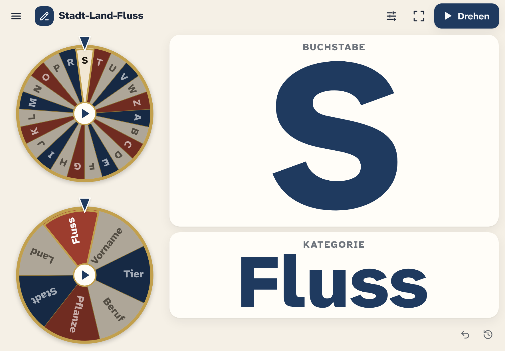
</p>

<table>
  <tr>
    <td align="center" width="33%">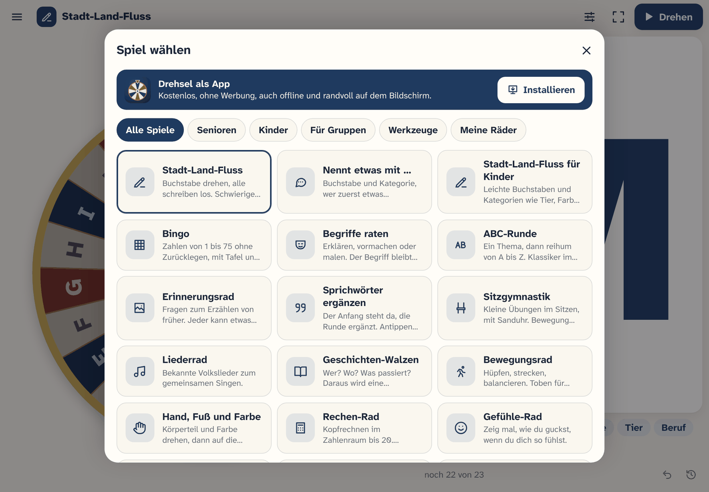<br><sub>30 Spiele und Werkzeuge</sub></td>
    <td align="center" width="33%">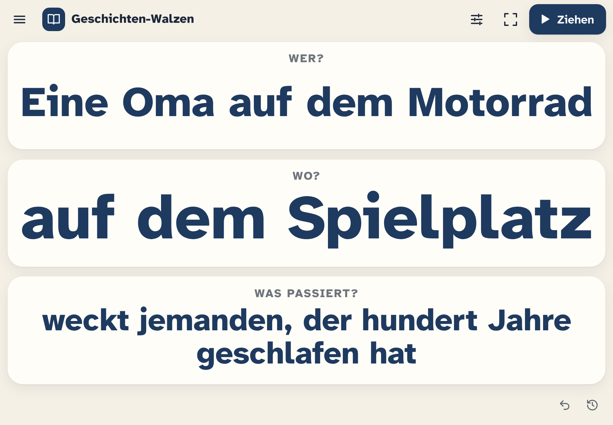<br><sub>Mehrere Dinge auf einmal</sub></td>
    <td align="center" width="33%">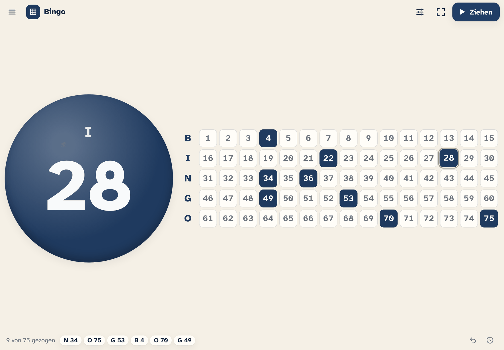<br><sub>Bingo mit Tafel und Ansage</sub></td>
  </tr>
  <tr>
    <td align="center">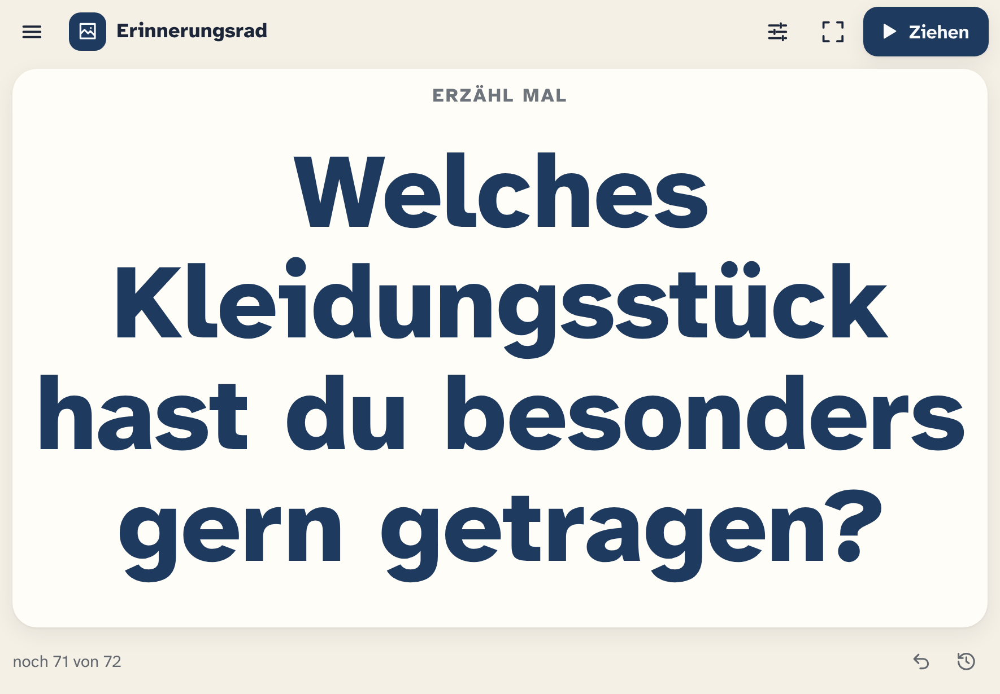<br><sub>Karte für lange Texte</sub></td>
    <td align="center">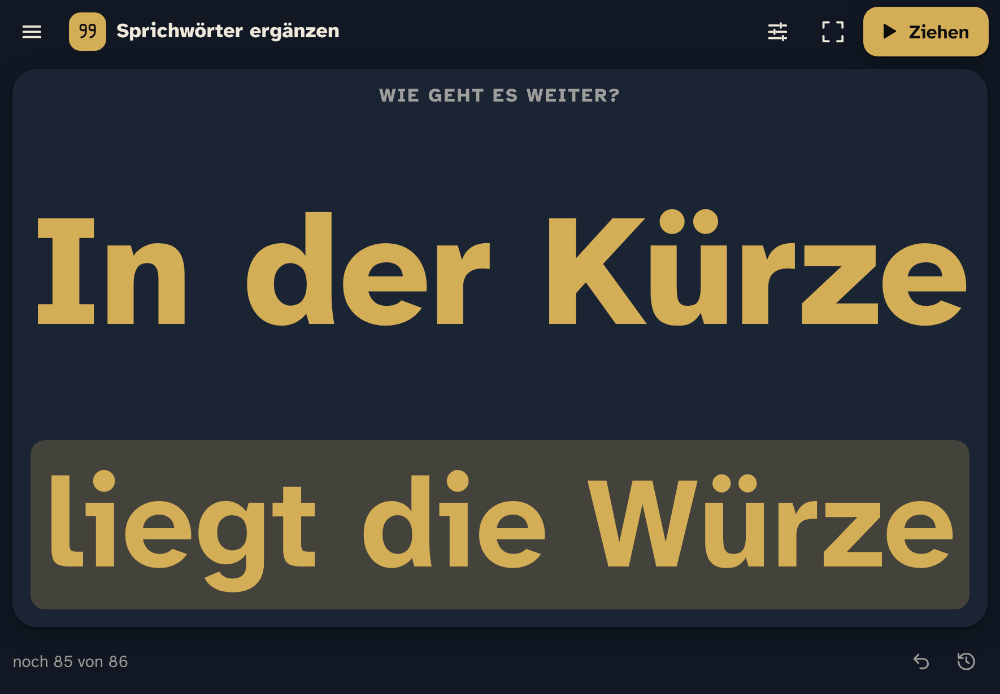<br><sub>Auflösung zum Antippen</sub></td>
    <td align="center">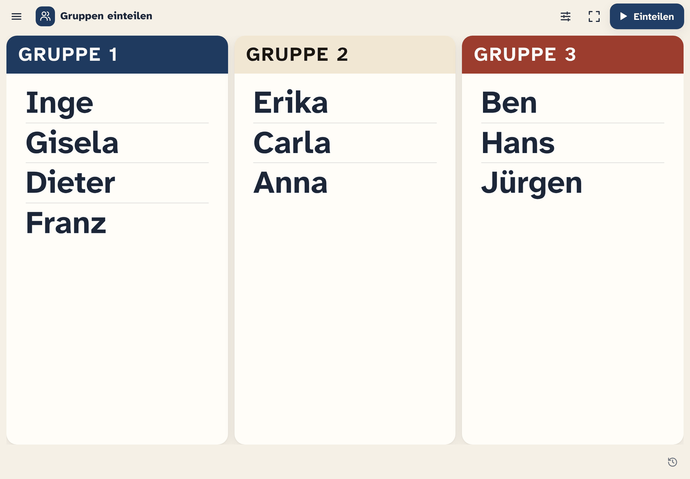<br><sub>Gruppen einteilen</sub></td>
  </tr>
  <tr>
    <td align="center">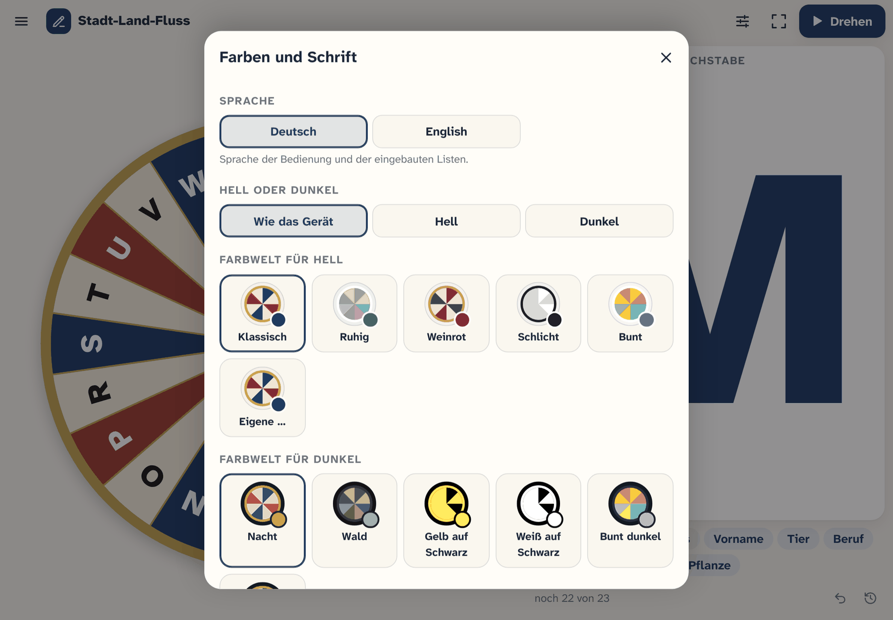<br><sub>Farbwelten für hell und dunkel</sub></td>
    <td align="center">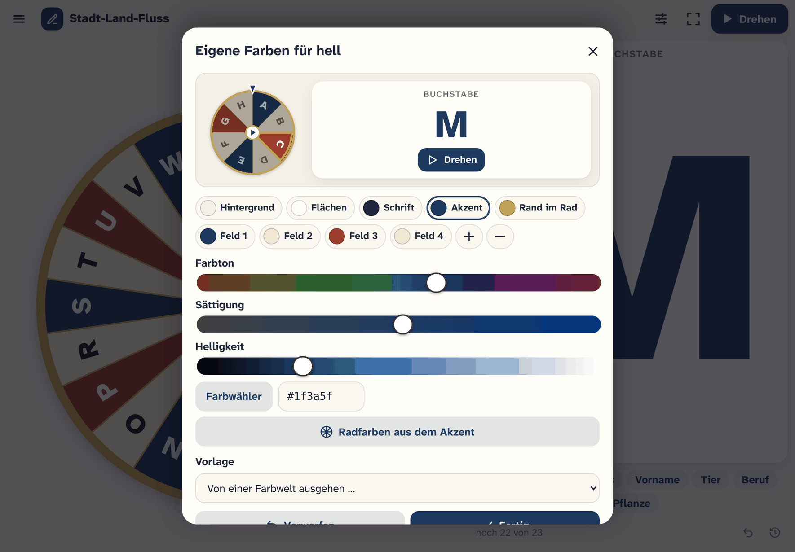<br><sub>Farbmischer für alle Farben</sub></td>
    <td align="center">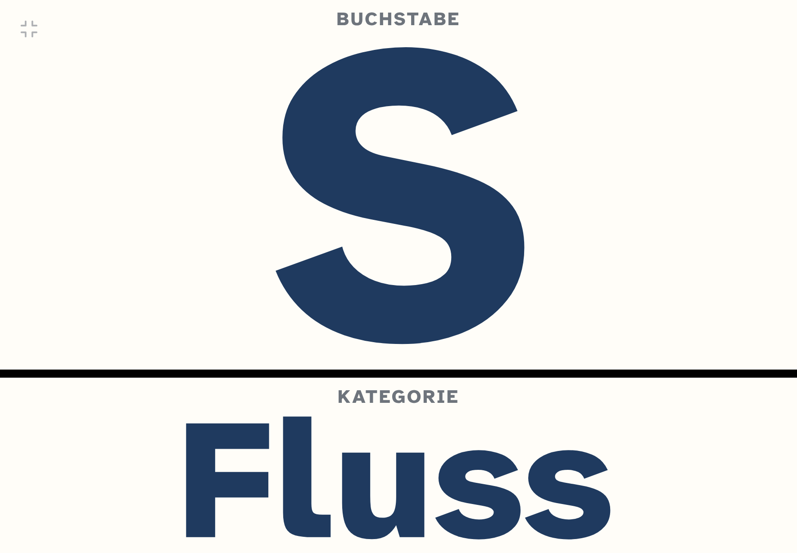<br><sub>Vorführmodus für Fernseher und Beamer</sub></td>
  </tr>
  <tr>
    <td align="center">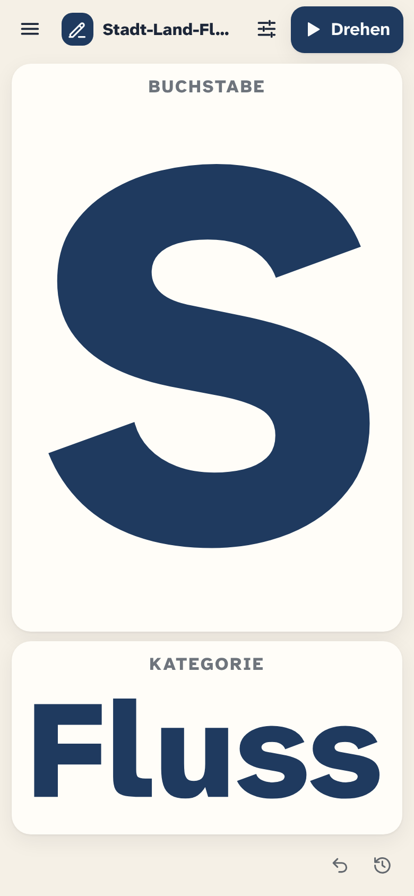<br><sub>Am Handy</sub></td>
    <td align="center">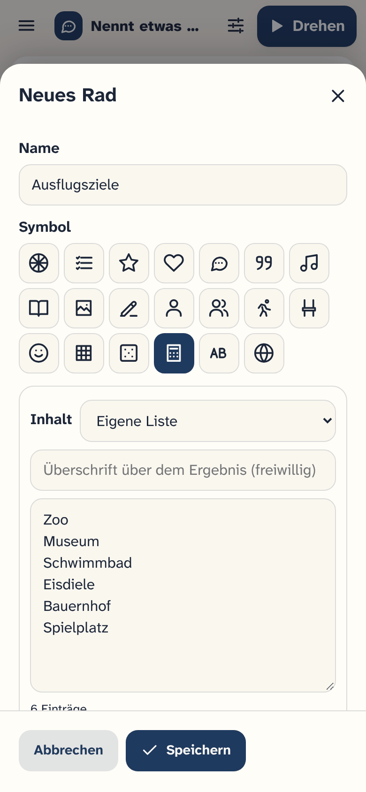<br><sub>Eigene Räder in einer Minute</sub></td>
    <td align="center">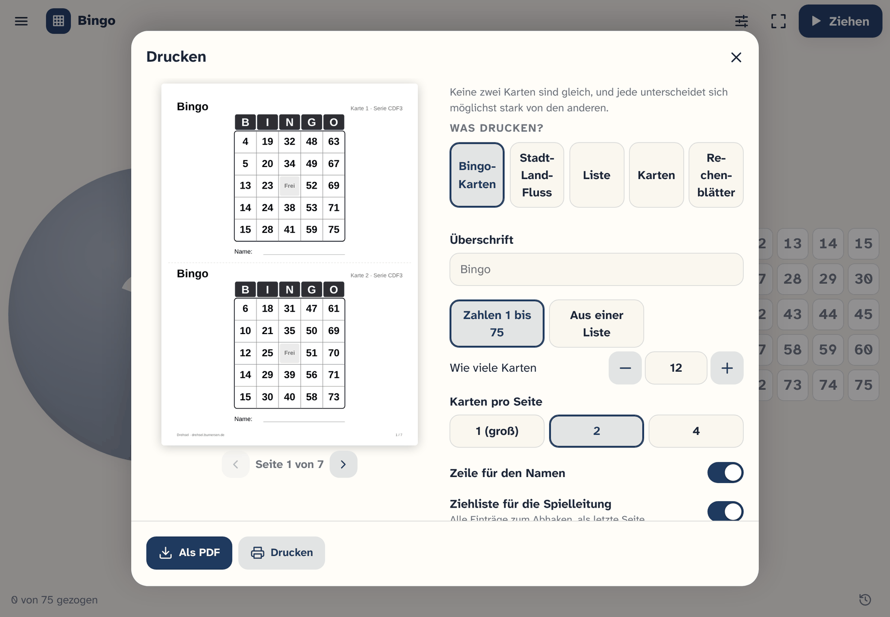<br><sub>Bingo-Karten drucken, jede anders</sub></td>
  </tr>
  <tr>
    <td align="center" colspan="3">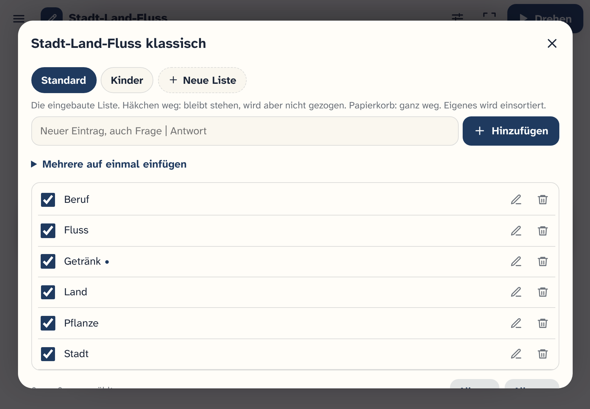<br><sub>Jede Liste anpassen, mehrere Fassungen als Reiter</sub></td>
  </tr>
</table>

> 💜 **Gefällt dir Drehsel?** Ein ⭐ auf GitHub ist die einfachste Art, mir das zu sagen. Oder [erzähl mir, wofür du es nutzt](../../issues/new), ich lese jede Nachricht. Danke!

## Inhalt

[Spiele](#spiele) · [So geht's](#so-gehts) · [Gut lesbar](#gut-lesbar) · [Eigene Listen](#eigene-listen) · [Drucken](#drucken) · [Fernseher, Beamer, Apple TV](#fernseher-beamer-apple-tv) · [Wo die Daten liegen](#wo-die-daten-liegen) · [Drei Wege zu Drehsel](#drei-wege-zu-drehsel) · [Voraussetzungen](#voraussetzungen) · [Installation](#installation) · [Updates](#updates) · [Aufbau](#aufbau) · [Listen und Sprachen erweitern](#listen-und-sprachen-erweitern) · [Lizenz](#lizenz)

## Spiele

| Für alle | Senioren | Kinder | Werkzeuge |
|---|---|---|---|
| **Generator** (nur das Ergebnis, bildschirmfüllend) | | | **Glücksrad** (ein Rad, so groß wie der Bildschirm) |
| Stadt-Land-Fluss (Buchstabe und Kategorie, Sanduhr) | Erinnerungsrad (72 Fragen von früher) | Geschichten-Walzen (Wer? Wo? Was passiert?) | Buchstaben (ohne Wiederholung, schwierige abwählbar) |
| Nennt etwas mit … (Buchstabe und Kategorie) | Sprichwörter ergänzen (86, mit Auflösung) | Bewegungsrad (40 Übungen zum Toben) | Zahlen (Bereich, Schrittweite, mit oder ohne Zurücklegen) |
| Bingo (1 bis 75, Tafel, Ansage) | Sitzgymnastik (35 Übungen, Sanduhr) | Hand, Fuß und Farbe | Würfel (1 bis 9, mit Augen und Summe) |
| Begriffe raten (verdeckt, erklären, vormachen, malen) | Liederrad (Volkslieder) | Rechen-Rad (Plus, Minus, Mal, Geteilt) | Lotto 6 aus 49 |
| ABC-Runde (Thema, dann A bis Z) | | Gefühle-Rad, Reim-Rad, Kinderlieder | Ja oder Nein, Münze werfen |
| | | Was wäre, wenn …? (Erzählfragen) | Wer ist dran?, Gruppen einteilen, Ämter verteilen |

Jedes Spiel lässt sich anpassen, und eigene Räder kommen beliebig dazu.

## So geht's

- **Drehen:** oben auf „Drehen“, aufs Rad oder irgendwo auf die Fläche tippen. Mit Schwung über das Rad wischen dreht in diese Richtung. Am Rechner gehen Leertaste, Enter und Pfeiltasten, also auch ein Präsentations-Klicker.
- **Bildschirmfüllend:** Das Rad dreht über die ganze Fläche, bleibt kurz stehen, dann steht das Ergebnis über die ganze Fläche. Erst das nächste Antippen dreht wieder. Umstellbar unter Menü → Farben und Schrift → Anzeige.
- **Schneller fertig:** während es dreht noch einmal antippen.
- **Generator und Glücksrad:** zum selbst Füttern mit Zahlen von bis, Buchstaben, jeder eingebauten Liste, eigenen Einträgen oder Namen. Der Generator zeigt nichts als das Ergebnis, über den ganzen Bildschirm, das Glücksrad dreht so groß, wie der Bildschirm ist.
- **Darstellung:** Rad zum Zuschauen, Karte mit Überschrift (auch für mehrere Dinge auf einmal und lange Texte wie Fragen), „Nur Ergebnis“ ganz ohne alles andere, Tafel zum Abhaken wie beim Bingo. Umschalten unter „Anpassen“ (Regler-Knopf oben).
- **Zusammen oder einzeln:** Bei mehreren Walzen, etwa Buchstabe und Kategorie, zieht ein Antippen alles neu. Auf Wunsch zieht das Antippen einer Walze nur sie neu (am Rechner auch mit den Tasten 1 bis 6). Eine Walze kann auch nur als Leiste darunter stehen, etwa die Kategorien zum Aufschreiben.
- **Ziehen:** mit Wiederholung, jeder einmal und dann von vorn, oder jeder nur einmal bis zur neuen Runde (wie beim Bingo). Bei „jeder einmal“ zeigt das Rad nur noch, was im Topf ist.
- **Auflösung:** Sprichwörter, Reime und Rechenaufgaben zeigen die Antwort erst beim Antippen.
- **Verdeckt:** bei „Begriffe raten“ sieht den Begriff nur, wer ihn antippt.
- **Sanduhr:** auf Wunsch je Spiel, startet nach dem Drehen von selbst, mit Gong am Ende.
- **Vorlesen:** von Haus aus aus. Eingeschaltet liest Drehsel mit der besten Stimme, die das Gerät hat, Buchstaben so, wie man sie sagt („Buchstabe: Emm. Kategorie: Tier.“). Die Stimme lässt sich wählen. Die Siri-Stimmen gibt Apple für Webseiten leider nicht frei.
- **Rückgängig und Verlauf:** unten rechts, dort auch „Neue Runde“. Die zuletzt gezogenen Ergebnisse lassen sich auf Wunsch unten einblenden, von Haus aus bleibt der Platz dem aktuellen Ergebnis.
- **Fairer Zufall:** das Ergebnis kommt aus dem echten Zufallsgenerator des Geräts, gleichmäßig verteilt. Das Rad dreht nur noch dorthin.

## Gut lesbar

- **Randvoll:** Buchstaben, Zahlen und Wörter werden nach ihren echten Umrissen eingepasst, nicht nach der Textzeile mit ihrem Platz für Ober- und Unterlängen. Ein einzelner Buchstabe füllt so fast die ganze Fläche, am Handy genauso wie am Fernseher. Wörter werden nie getrennt.
- **Mehrere Ergebnisse** stehen neben- oder untereinander, je nachdem, wo alle größer werden. Die Aufteilung richtet sich nach der Länge der Einträge und springt beim nächsten Drehen nicht.
- **Würfel mit dicken Augen**, gut zu zählen auch von hinten im Raum.
- **Fünf Schriften, alle eingebaut:** Atkinson Hyperlegible (vom Braille Institute für Menschen mit Sehschwäche), Fibel (nach Andika, für Leseanfänger), Lexend, Nunito und die Schrift des Geräts.
- **Farbwelten:** Klassisch, Ruhig, Weinrot, Schlicht und Bunt für hell, Nacht, Wald, Gelb auf Schwarz, Weiß auf Schwarz und Bunt dunkel für dunkel. Hell oder dunkel fest oder wie das Gerät.
- **Farbmischer:** Hintergrund, Flächen, Schrift, Akzent, Rand und jede Feldfarbe im Rad selbst einstellen, mit Vorschau, Farbwähler und Farbcode.
- **Kontrast-Automatik:** jede Schrift wird so nachgeregelt, dass sie auf ihrem Untergrund gut lesbar bleibt, große Ergebnisse mindestens 7 : 1, alles andere mindestens 4,5 : 1. Auch die Beschriftung jedes Felds im Rad.
- **Schriftgrößen:** Regler für Bedienung, Ergebnis, Beschriftung im Rad und Nebentexte, dazu die Stärke und auf Wunsch GROSSBUCHSTABEN.

## Eigene Listen

- **Neues Rad:** Name, Symbol, Einträge eintippen oder einfügen. Mehrere Walzen für Kombinationen.
- **Jede Liste anpassen:** jeder Eintrag mit Häkchen (bleibt stehen, wird aber nicht gezogen), Stift zum Ändern und Papierkorb zum Löschen, auch die eingebauten. Neues wird an seinem Platz im Alphabet einsortiert, als wäre es schon immer da gewesen. Mehrere Einträge auf einmal einfügen geht auch. Gelöschtes lässt sich zurückholen.
- **Mehrere Fassungen als Reiter:** „Neue Liste“ legt zu jeder Liste weitere Fassungen an, leer oder als Kopie, etwa eine für Kinder und eine für Erwachsene oder eigene Fragen der Bärengruppe. Ein Tipp auf den Reiter schaltet um.
- **Jede Walze, jede Liste:** unter „Anpassen“ kann jede Walze eine andere eingebaute Liste nehmen oder eine ganz eigene nur für dieses Spiel. Beim Stadt-Land-Fluss etwa die Kategorien für Senioren oder eigene.
- **Eigene Buchstaben und Silben:** zum Alphabet kommen auf Wunsch SCH, ST, EI oder was gebraucht wird.
- **Teilnehmer:** mehrere Namenslisten, etwa je Gruppe, umschalten per Reiter. Wer heute fehlt, bekommt das Häkchen weg.
- **Als eigenes Rad kopieren:** jedes eingebaute Spiel samt Einträgen, danach frei veränderbar.
- **Textdateien importieren und exportieren**, auch Listen aus WhatsApp, E-Mail oder einer Excel-Spalte einfügen.
- **Per Link teilen:** das Rad steckt im Link hinter dem `#`. Dieser Teil geht nie an den Server, gespeichert wird nichts.
- **Sicherung als Datei:** alles mitnehmen auf ein anderes Gerät.

Das Textformat, das Drehsel liest und schreibt:

```
[Ausflugsziele]
Zoo
Museum
Spielplatz | mit Picknick

== Abendessen ==
[Vorspeise]
Suppe
Salat
[Hauptgang]
Nudeln
Fisch
```

Eine Zeile pro Eintrag. `[Name]` beginnt eine Liste, `== Name ==` ein Rad mit mehreren Walzen. Hinter `|` steht eine Auflösung, die erst beim Antippen erscheint. Mit `#rrggbb` am Zeilenende bekommt ein Feld seine eigene Farbe, etwa `Rot #e03131`. Zwei Spalten aus Excel werden zu Frage und Antwort.

## Drucken

Unter Menü → Drucken (oder „Drucken …“ beim Anpassen eines Spiels) entsteht ein A4-PDF, direkt im Browser, ohne fremde Bibliothek und ohne Netz. Die Vorschau zeigt genau, was aus dem Drucker kommt.

- **Bingo-Karten, jede anders:** klassisch mit den Zahlen 1 bis 75 (B I N G O, Freifeld in der Mitte) oder aus jeder Liste, 3 × 3, 4 × 4 oder 5 × 5 Felder. Keine zwei Karten haben dieselben Einträge, auch nicht in anderer Anordnung, und jede unterscheidet sich möglichst stark von den anderen, damit selten mehrere auf einmal gewinnen. Gibt eine Liste nicht genug verschiedene Karten her, sagt Drehsel, wie viele möglich sind. 1, 2 oder 4 Karten pro Seite, Kartennummer und Serie, auf Wunsch eine Zeile für den Namen und eine Ziehliste für die Spielleitung.
- **Stadt-Land-Fluss-Blatt:** quer, mit Spalten für Buchstabe, Kategorien und Punkte. Auf Wunsch bekommt jedes Blatt andere, zufällige Kategorien.
- **Liste:** jede Liste in normaler, großer oder sehr großer Schrift, in 1 bis 3 Spalten, mit Nummern oder Kästchen, Auflösungen darunter oder am Ende.
- **Karten zum Ausschneiden:** 4, 6, 8 oder 12 pro Seite mit Schnittlinien, etwa Erinnerungsfragen oder Begriffe, die Auflösung klein unten.
- **Rechenblätter, jedes anders:** Plus, Minus, Mal, Geteilt im Zahlenraum bis 10, 20, 100 oder 1000. Jedes Blatt hat andere Aufgaben, die Lösungen stehen hinten.

## Fernseher, Beamer, Apple TV

- **Vorführmodus** (Knopf mit den vier Ecken oder Taste F): nur noch Rad und Ergebnis, randvoll, auf Wunsch auf Schwarz, Bildschirm bleibt an. Antippen dreht, oben links geht es zurück. Überschriften und Leisten wachsen mit dem Bildschirm mit.
- **iPhone:** Safari lässt Webseiten nicht ins echte Vollbild. Als App auf dem Home-Bildschirm (Teilen → „Zum Home-Bildschirm“) verschwinden alle Leisten.
- **iPad auf Apple TV:** iPad quer halten und im Kontrollzentrum die Drehsperre einschalten. Das iPad hat ein anderes Format als der Fernseher (etwa 4:3 statt 16:9), deshalb bleiben beim Spiegeln links und rechts Ränder. Mit schwarzem Hintergrund im Vorführmodus fallen sie kaum auf. Als App installiert verschwinden zusätzlich die Leisten von Safari.
- Ein eigenes 16:9-Bild für den Fernseher können nur Apps aus dem App Store senden, eine Web-App kommt da nicht ran.

## Wo die Daten liegen

**Alles bleibt auf dem Gerät:** eigene Räder, Anpassungen, Teilnehmer, Einstellungen, Verlauf. Nichts davon geht an den Server. Drehsel setzt keine Cookies, zählt niemanden und lädt nichts von fremden Servern nach, keine Schriften, keine Skripte, keine Statistik.

**Was der Server speichert:** nichts über Besucher. Im Ordner `data/` liegen nur die Einstellungen und der Stand der Updates.

**Was nach außen geht:** nur die Frage an GitHub nach einer neuen Version, höchstens alle 15 Minuten. Persönliches geht dabei nicht raus.

## Drei Wege zu Drehsel

1. **Einfach benutzen:** [drehsel.burnersen.de](https://drehsel.burnersen.de) öffnen und als App installieren (am iPhone und iPad über Teilen → „Zum Home-Bildschirm“). Danach läuft Drehsel auch ohne Internet.
2. **Ohne Server, als Datei:** `drehsel-offline.html` aus dem [neuesten Release](../../releases/latest) laden und per Doppelklick öffnen, am Rechner oder vom USB-Stick. Alles steckt in dieser einen Datei (rund 500 KB). Auf iPhone und iPad lieber Weg 1, dort laufen HTML-Dateien aus den Dateien nicht richtig.
3. **Auf dem eigenen Webspace:** siehe [Installation](#installation).

## Voraussetzungen

- PHP 7.4 oder neuer (empfohlen 8.x). Keine Datenbank.
- **HTTPS.** Ohne HTTPS lässt sich die App nicht installieren und läuft nicht offline.
- Für Updates von selbst: `curl` oder `allow_url_fopen`, und der Webspace muss ausgehende Verbindungen erlauben.
- Apache und LiteSpeed sperren die internen Ordner von selbst über `.htaccess`. **nginx** braucht zwei Zeilen, siehe unten.

## Installation

1. Aus dem [neuesten Release](../../releases/latest) die Datei `drehsel-install.php` herunterladen und in ein Verzeichnis auf dem Webserver kopieren, zum Beispiel `/drehsel/`.
2. PHP muss in dieses Verzeichnis schreiben dürfen (es legt dort `index.php`, den Ordner `app/` und später `data/` an).
3. `drehsel-install.php` im Browser aufrufen und auf „Jetzt installieren“ klicken. Die Datei packt das Programm aus, löscht sich selbst und leitet zu Drehsel weiter.
4. **Prüfen, dass die internen Ordner gesperrt sind:** `https://deine-adresse/drehsel/data/config.php` und `https://deine-adresse/drehsel/app/lib/core.php` müssen „403 Forbidden“ oder „404 Not Found“ zeigen.

**Lieber von Hand?** Im Release liegt auch `drehsel-<Version>.zip`. Entpacken und den Inhalt des Ordners `drehsel/` hochladen, also `index.php`, `LICENSE` **und** den Ordner `app/`.

**nginx:** diese zwei Zeilen in den `server`-Block, vorher die Konfiguration sichern:

```sh
# Sicherung der Konfiguration (Pfad je nach System)
sudo cp -a /etc/nginx/sites-available/default /etc/nginx/sites-available/default.bak

# Eintragen (Drehsel liegt hier im Ordner /drehsel/):
#   location ^~ /drehsel/data/ { deny all; }
#   location ^~ /drehsel/app/  { deny all; }
sudo nano /etc/nginx/sites-available/default

# Prüfen und neu laden
sudo nginx -t && sudo systemctl reload nginx

# Falls etwas schiefgeht: zurückholen und neu laden
sudo cp -a /etc/nginx/sites-available/default.bak /etc/nginx/sites-available/default && sudo systemctl reload nginx
```

## Updates

**Von selbst:** Drehsel schaut höchstens alle 15 Minuten beim neuesten Release auf GitHub nach, und zwar erst, nachdem eine Seite ausgeliefert ist. Gibt es eine neue Version, wird der Installer heruntergeladen, per Prüfsumme kontrolliert und eingespielt. Die laufende Version wird vorher in `data/update-prev.txt` gesichert, `data/` bleibt unangetastet. Die Geräte holen sich die neue Version beim nächsten Öffnen.

Abschalten in `data/config.php`:

```php
return array (
  'auto_update' => false,
);
```

**Von Hand:** den neuen `drehsel-install.php` hochladen und aufrufen.

## Aufbau

```
index.php      Einstieg: Dateien ausliefern, Service Worker, Manifest, die Seite
app/lib/       Einstellungen, Kopfzeilen, Updates (PHP)
app/views/     die Hauptseite, auch Vorlage für die Offline-Datei
app/assets/    die App im Browser:
               engine.js  Zufall, Ziehen, Verlauf, Gruppen, Ämter, Teilen, Bingo-Karten, Rechenblätter, eingebaute Spiele
               pdf.js     PDF ohne fremde Bibliothek, mit Vorschau; print.js die Druckvorlagen
               stage.js   Rad, Karte, Würfel, Bingo-Tafel, Sanduhr, randvolle Einpassung der Ergebnisse
               look.js    Farbwelten und Kontrast-Automatik
               app.js     Bedienung, Fenster, Einstellungen, eigene Räder, Sicherung
               i18n-en.js Übersetzung, Schriften (WOFF2), Symbole, Service Worker, CSS
app/lists/     die eingebauten Listen, eine Textdatei pro Sprache
app/licenses/  Lizenzen der Schriften (SIL Open Font License)
tools/         Release bauen, Logik, Listen und Übersetzungen prüfen (nur Kommandozeile)
```

Keine Frameworks, keine Abhängigkeiten, kein Build-Schritt, keine Datenbank.

## Listen und Sprachen erweitern

Die eingebauten Listen stehen in `app/lists/de.txt` und `app/lists/en.txt`:

```
[sprichwoerter] Sprichwörter
Morgenstund hat | Gold im Mund
Übung macht | den Meister
```

`[id] Name` beginnt eine Liste, darunter ein Eintrag pro Zeile. Die ids sind in allen Sprachen gleich, die Spiele selbst stehen in `app/assets/engine.js`.

**Neue Sprache:** `app/assets/i18n-en.js` als `i18n-xx.js` kopieren, `_name` setzen und die Texte übersetzen, dazu `app/lists/xx.txt` anlegen. Drehsel findet beides von selbst.

Zum Prüfen:

```sh
node tools/test-engine.js     # Zufall, Ziehen, Rückgängig, Gruppen, Ämter, Teilen, Bingo-Karten, Rechenblätter
node tools/check-lists.js     # doppelte Einträge, fehlende Listen
node tools/check-i18n.js      # fehlende Übersetzungen
php tools/build-release.php   # dist/drehsel-install.php, ZIP und drehsel-offline.html
```

Auf GitHub prüft die Action „Prüfen“ jeden Pull Request. Ein Tag wie `1.0.1` startet die Action „Release“, die alle Dateien baut und anhängt.

## ☕ Unterstützen

Drehsel ist kostenlos und entsteht in meiner Freizeit. Wenn es dir Freude macht und du Danke sagen möchtest, kannst du [ein kleines Trinkgeld bei Ko-fi dalassen](https://ko-fi.com/burnersen). Völlig freiwillig, und in jedem Fall: danke!

**Mehr von mir:** [Suchsel](https://suchsel.burnersen.de) (Wortsuchrätsel mit eigenen Wörtern, zum Ausdrucken), [Kaufen](https://kaufen.burnersen.de) (gemeinsame Einkaufslisten) und alles Weitere auf [tech.burnersen.de](https://tech.burnersen.de/).

## Lizenz

GNU Affero General Public License v3.0, siehe [LICENSE](LICENSE). Die Schriften stehen unter der SIL Open Font License 1.1, siehe [app/licenses/](app/licenses/).
